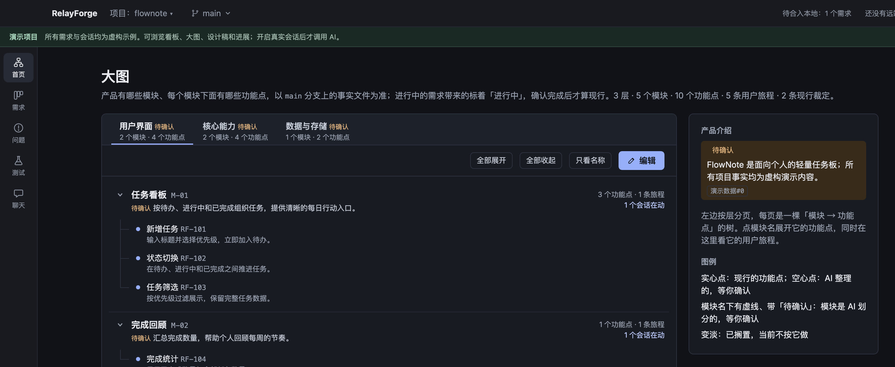
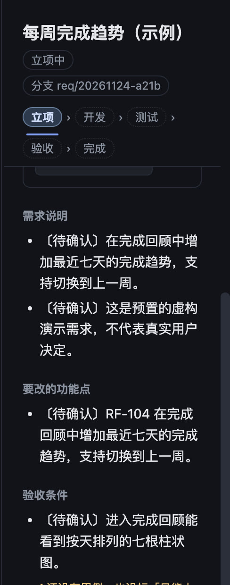
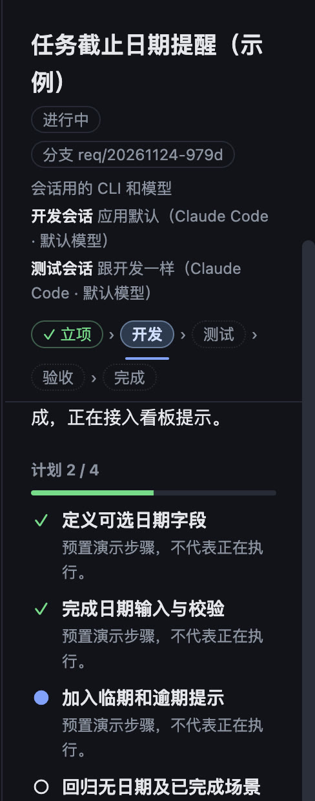
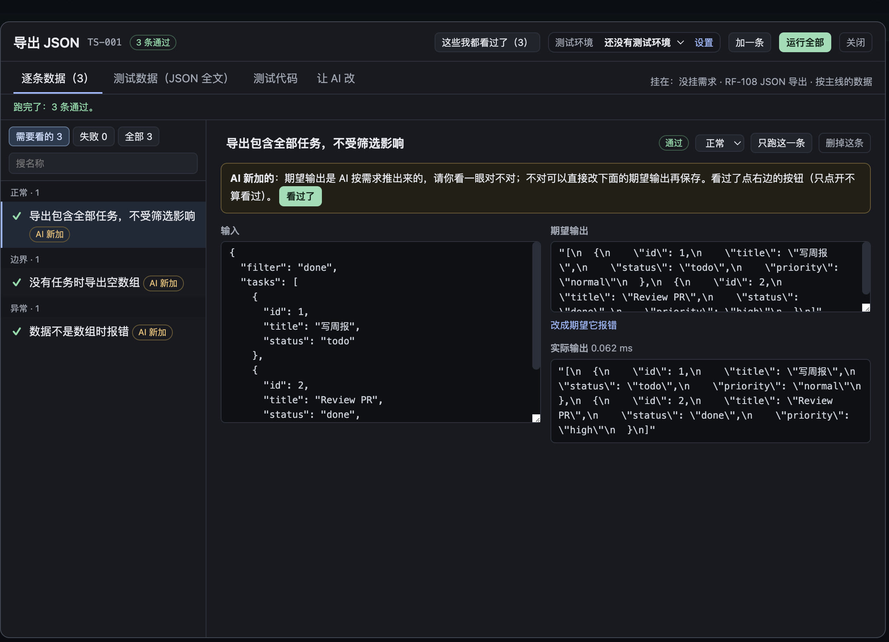
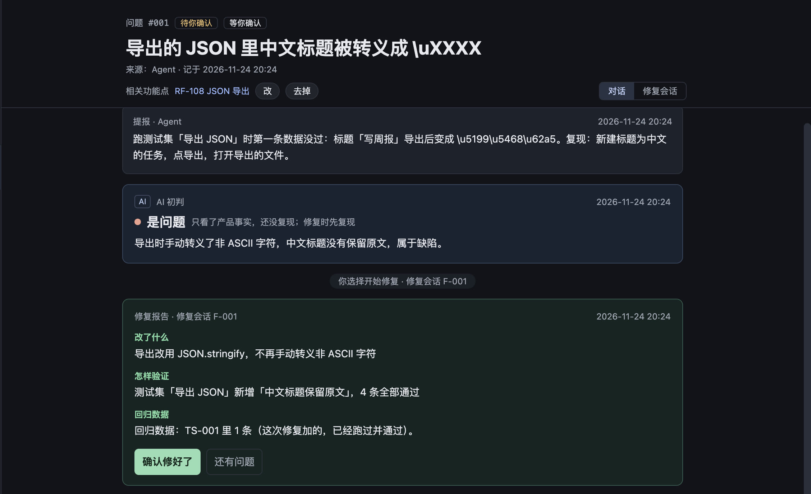
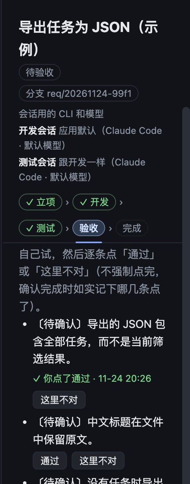

# RelayForge

[中文](README.md) | **English**

RelayForge is a local macOS desktop workbench for software development. It manages requirements, issues and everyday chats on your machine, embeds Claude Code or Codex sessions in the window, and takes each requirement through scoping, development, testing, acceptance and merge on its own Git branch and worktree.

The app shell is Electron; the backend is `rf.py` and the `relayforge` package, written with the Python standard library only. Project facts are kept outside Git in `.relayforge/` (by default under `~/.relayforge/projects/` on your machine); the repository only commits a project ID. The app has no server of its own, and models are called through the CLI installed on your machine.

> Note: most in-repo documentation is written in Chinese; the app itself has an English UI.

## Features

- **Requirements and issues**: a board for requirements (scoping, in progress, testing, awaiting acceptance, done, cancelled). Issues can be triaged, fixed, handed to AI for investigation, or converted to and from requirements.
- **AI sessions**: every requirement has its own branch and working directory, with dedicated sessions for scoping, development, testing, fixing and casual chat. Session progress and program messages are recorded; testing, fixing and merging can run headless in the background.
- **Testing and acceptance**: test sets consist of data, integration code and program comparison. Test environments hold variables, secrets and external dependencies. Setup steps and build commands need your confirmation in the app before their first run. Services for manual acceptance are started, stopped and logged by the app.
- **Facts and the big picture**: modules, features, user journeys, decisions, designs and documents make up the product facts. The big picture shows modules and features layer by layer, and designs preview in an isolated window.
- **Git and release**: finished requirements and fixes are merged through a merge queue into the current branch of the project's main checkout. Pushing happens only when you click "Publish" in the app.

## Demo


https://github.com/user-attachments/assets/356d3a44-a6a0-42f1-90cf-761a377794a7


> The 57-second promo video (also on the website home page).

## Screenshots

One requirement in the FlowNote demo project, from scoping to acceptance:

### 1. Open your project — AI drafts the product map



### 2. New requirement: scope it before any code



### 3. Build: every step in view



### 4. Test: a suite that grows, rerun in one click



### 5. Bugs flow back: AI fixes, you confirm



### 6. Accept, merge, and the map follows



## Running

Requires macOS, Node.js 20+, Python 3.10+, Git, and an installed and signed-in Claude Code or Codex CLI.

```sh
cd app
npm ci
npm start
```

On first launch the app opens the FlowNote demo project generated from `test-project/`; browsing the demo does not call any model. Switch to your own project from the project menu, or specify it at startup:

```sh
RELAYFORGE_PROJECT=/path/to/project npm start
```

A project must be a Git repository; if it is not initialized yet, the app asks whether to initialize it. "Settings" at the bottom left chooses Claude Code or Codex for new sessions.

See the [desktop app docs](app/README.md) (Chinese) and the [demo project](test-project/README.md).

## How a requirement flows

1. Create a requirement; the app opens its branch, working directory and scoping session.
2. In the scoping session, settle the description, the features to change and the acceptance criteria (draw a design if there is a UI), then click "Confirm and start development".
3. The development session changes code on the requirement's own branch; the testing session turns the acceptance criteria into test sets or manual check steps and runs them until they pass.
4. After you try it out and pass each acceptance item, confirm completion and the program merges the changes back into the main checkout's current branch.
5. Problems found along the way can be logged as issues at any time; after AI triage you decide to fix, convert to a requirement, investigate, or defer.

A cancelled requirement keeps its branch, content and sessions, and can be restored later.

## Website (relayforge_backend)

The website lives in a separate repository, `relayforge_backend` (by default a sibling of this one: `~/ai/relayforge_backend`). It introduces the app, serves the dmg download and collects feedback.

- Home, download and feedback pages: Chinese at the root path, English under `/en`.
- The dmg and changelog are read from this project's GitHub Releases (cached for 10 minutes; pages still open if GitHub is unavailable). To ship a version, just create a Release and upload the `.dmg`.
- Feedback: a web form plus an app-facing API, `POST /api/v1/feedback`. Anonymous submission is allowed, email is optional, and progress can be checked by ID (`GET /api/v1/feedback/{id}`).
- Admin at `/admin`: only the site owner can sign in. Change status, reply to users, add internal notes, view logs and screenshots, and copy an item into a RelayForge requirement in one click.
- Stack: Python 3.11+, FastAPI, Jinja2 templates, SQLite, no front-end build step. `scripts/publish_pages.sh` can also build a static site and publish it to GitHub Pages.

Local preview:

```sh
cd ~/ai/relayforge_backend
uv sync
uv run python scripts/dev_preview.py   # open http://127.0.0.1:8765, admin password: dev
```

Deployment, API fields, spam-feedback detection and privacy notes are in that repository's `README.md` (Chinese).

## Repository layout

| Path | Purpose |
| --- | --- |
| `app/` | Electron desktop app (main process, preload, UI scripts, design window, manual-acceptance services); see [app/README.md](app/README.md) |
| `backend/` | Python backend and the `rf.py` CLI; code in `backend/relayforge/`, split into `core/`, `facts/`, `requirements/`, `issues/`, `testsets/`, `envs/`, `sessions/`, `project/` |
| `tests/` | Backend and desktop tests |
| `test-project/` | Offline FlowNote demo template, sample data and its generator |
| `docs/` | Product design drafts, designs and interaction prototypes |
| `icon/` | App icon |
| `AGENTS.md` | Development and commit conventions for this repository |

`archive/` is an archive of early experiments and historical implementations, not an entry point of the current app.

## Development and testing

Install dependencies once:

```sh
cd app
npm ci
```

Run the full checks before committing:

```sh
python3 -B -m unittest discover -s tests -p 'test_*.py'   # backend
node --test tests/test_app_*.cjs                           # desktop
cd app && npm run lint                                     # ESLint
```

If you changed the UI script load order or the backend commands the app calls, also open the demo project with `cd app && npm start` and look at it. Workflow, layering and directory conventions are in [AGENTS.md](AGENTS.md) (Chinese); contribution terms are in [CONTRIBUTING.md](CONTRIBUTING.md).

## Data and security

- Project records are externalized by default to `~/.relayforge/projects/`; `.relayforge` in the project directory is a link to it. The repository commits only the project ID in `.relayforge.json`, never the records.
- Secrets of test environments exist only on your machine with mode 600. Logs, test results and text handed to sessions are redacted first. Secrets never enter the repository.
- Claude Code sessions opened by the app, and background reviews, run inside the OS sandbox; if the sandbox is not in effect, no session is opened. A session cannot impersonate the app to run user-only commands.
- Before setup steps, service start commands and test-set build commands run for the first time, you must view their actual content in the app and agree; consent is remembered by a fingerprint of the command and working directory.
- Report security issues privately following [SECURITY.md](SECURITY.md); do not open a public issue.

## More docs

- [Desktop app](app/README.md)
- [Demo project](test-project/README.md)
- [Product design drafts](docs/product/)
- [Designs and design notes](docs/design/)
- [Interaction prototypes](docs/prototype/)
- [Development conventions](AGENTS.md)
- [Contributing](CONTRIBUTING.md)
- [Reporting security issues](SECURITY.md)
- Website: `README.md` in the `relayforge_backend` repository

## License

Licensed under the [Functional Source License 1.1, Apache 2.0 Future License](LICENSE) (FSL-1.1-ALv2). The source is public, but this is not an OSI-approved open-source license.

- You may use it personally, use it inside your company, modify it, use it for teaching and non-commercial research, and use it to provide professional services to clients, all without extra permission.
- You may not use it for a "competing purpose": offering this project or a modified version to others as a commercial product or service that substitutes for it or provides the same or substantially similar functionality (including hosted services and renamed desktop apps). Such uses need a separate license.
- Redistribution must include the license terms or a link to them, and keep the copyright notice. The program copy that `init` places into a project (`.relayforge/bin/`) carries a LICENSE.
- Two years after each version is released, it may automatically be used under the Apache License 2.0.
