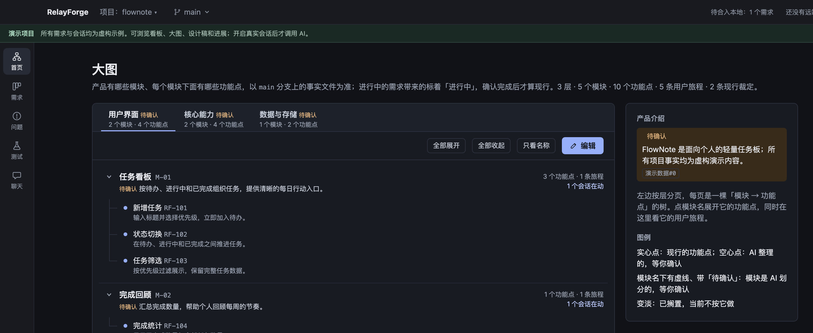
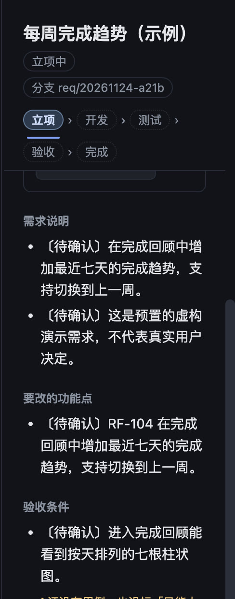
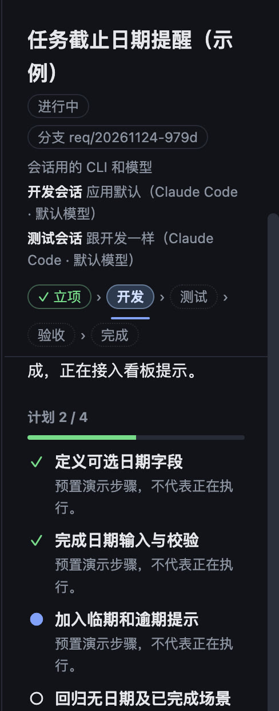
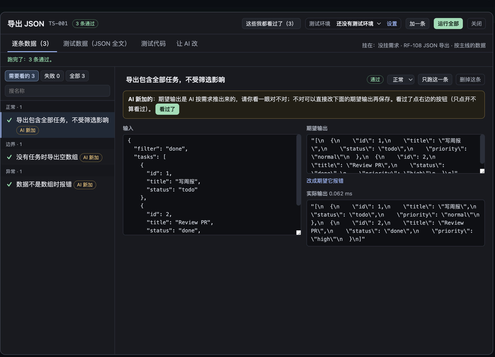
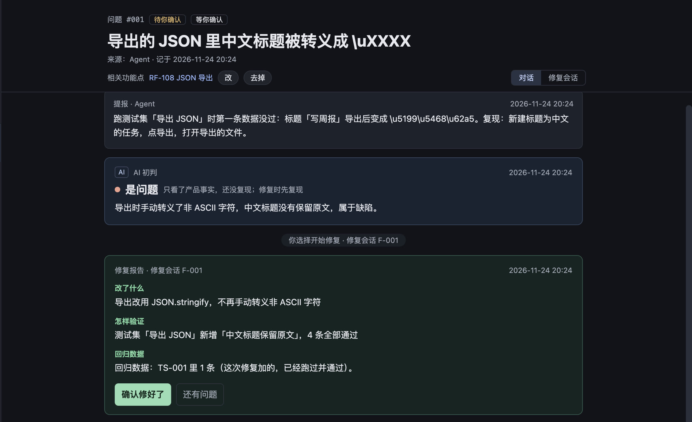
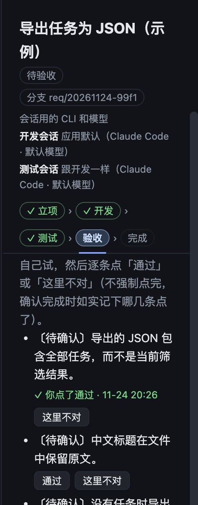

# RelayForge · 接力工坊

RelayForge 是一个 macOS 桌面开发工作台。它在本地管理需求、问题和日常聊天，把 Claude Code 或 Codex 会话嵌在窗口里，围绕每个需求自己的 Git 分支和工作目录完成立项、开发、测试、验收和合并。

应用主进程是 Electron，后端是 Python 标准库实现的 `rf.py` 和 `relayforge` 包。项目事实保存在 Git 之外的 `.relayforge/`（默认在本机 `~/.relayforge/projects/`），仓库里只提交一个项目 ID；应用本身没有服务端，模型由本机 CLI 调用。

**中文** | [English](README.en.md)

## 主要能力

- **需求和问题**：看板管理立项中、进行中、测试中、待验收、已完成和已取消的需求；问题可以初判、修复、交给 AI 排查，或在需求和问题之间转换。
- **AI 会话**：每个需求有自己的分支和工作目录，立项、开发、测试、修复和日常聊天各用对应的会话；会话进展和程序消息都有记录，测试、修复和合并可以在后台无界面运行。
- **测试和验收**：测试集由数据、接入代码和程序比对组成；测试环境保存变量、保密值和外部依赖；准备步骤和构建命令第一次执行前要你在应用里确认；人工验收的服务由应用启动、停止和收集日志。
- **事实和大图**：模块、功能点、用户旅程、决定、设计稿和文档登记构成产品事实；大图按层查看模块和功能点，设计稿在隔离的窗口中预览。
- **Git 和发布**：需求、修复完成时按合并队列合并进项目主目录的当前分支；推送只由你在应用里点「发布」触发。

## 演示


https://github.com/user-attachments/assets/83bb0176-1d09-4a94-a7bc-88a2acba958b


## 界面一览

演示项目 FlowNote 里一个需求从立项到验收的过程：

### 1. 打开你的项目，AI 先整理出产品大图



### 2. 新建需求，先立项再动手



### 3. 开发：每一步都看得见



### 4. 测试：越攒越多，一键重跑



### 5. 问题回流：AI 修好，你来确认



### 6. 验收、合并，大图跟着更新



## 运行

需要 macOS、Node.js 20+、Python 3.10+、Git，以及已安装并登录的 Claude Code 或 Codex CLI。

```sh
cd app
npm ci
npm start
```

首次打开默认使用 `test-project/` 生成的 FlowNote 演示项目；浏览示例不会调用模型。可以从项目菜单切换自己的项目，或在启动时指定：

```sh
RELAYFORGE_PROJECT=/path/to/project npm start
```

打开的项目需要是 Git 仓库；还没有初始化时，应用会先问你是否替它初始化。左下角「设置」用来选择 Claude Code 或 Codex，保存后用于新会话。

完整的使用说明见 [桌面应用文档](app/README.md)，演示项目见 [test-project/README.md](test-project/README.md)。

## 一个需求怎么走

1. 新建需求，应用开出它的分支、工作目录和立项会话。
2. 在立项会话里聊清需求说明、要改的功能点和验收条件；有界面时画设计稿。定好后点「确认立项，开始开发」。
3. 开发会话在需求自己的分支上改代码；测试会话把验收条件落成测试集或人工检查步骤，跑到通过。
4. 你试过并逐条通过验收后确认完成，程序把改动合并回项目主目录的当前分支。
5. 发现的问题可以随时记成「问题」，AI 初判后由你决定修复、转需求、排查或暂不处理。

不想继续的需求可以取消，取消前的分支、内容和会话都保留，之后可以恢复。

## 官网（relayforge_backend）

官网放在单独的仓库 `relayforge_backend`（本机默认与本仓库同级：`~/ai/relayforge_backend`），不在这个仓库里。它负责介绍应用、提供 dmg 下载和收集反馈。

- 首页、下载页、反馈页：中文在根路径，英文在 `/en`。
- dmg 和更新日志读取本项目的 GitHub Releases（缓存 10 分钟，GitHub 不可用时页面照常打开）；发新版本只需要建 Release 并上传 `.dmg`。
- 反馈：网页表单加一个给应用用的接口 `POST /api/v1/feedback`，可匿名、邮箱选填，按编号查进度（`GET /api/v1/feedback/{id}`）。
- 反馈后台 `/admin`：只有站长能登录，可以改状态、回复用户、写内部备注、看日志和截图，并一键复制成 RelayForge 需求。
- 技术栈：Python 3.11+、FastAPI、Jinja2 模板、SQLite，没有前端构建步骤；也可以用 `scripts/publish_pages.sh` 构建成静态站发布到 GitHub Pages。

本地预览：

```sh
cd ~/ai/relayforge_backend
uv sync
uv run python scripts/dev_preview.py   # 打开 http://127.0.0.1:8765 ，后台密码 dev
```

部署、接口字段、垃圾反馈判断和隐私说明见该仓库的 `README.md`。

## 工程目录

| 位置 | 用途 |
| --- | --- |
| `app/` | Electron 桌面应用（主进程、preload、界面脚本、设计稿窗口、人工验收服务），说明见 [app/README.md](app/README.md) |
| `backend/` | Python 后端和命令行 `rf.py`；代码在 `backend/relayforge/`，按 `core/`、`facts/`、`requirements/`、`issues/`、`testsets/`、`envs/`、`sessions/`、`project/` 分包 |
| `tests/` | 后端和桌面端测试 |
| `test-project/` | FlowNote 离线演示模板、示例数据和演示数据生成器 |
| `docs/` | 产品设计草稿、设计稿和交互原型 |
| `icon/` | 应用图标 |
| `AGENTS.md` | 在这个仓库里开发和提交的规范 |

仓库里还有 `archive/`，它是早期实验和历史实现的归档，不属于当前应用的使用入口。

## 开发与测试

第一次拉下依赖：

```sh
cd app
npm ci
```

提交前运行完整检查：

```sh
python3 -B -m unittest discover -s tests -p 'test_*.py'   # 后端
node --test tests/test_app_*.cjs                           # 桌面端
cd app && npm run lint                                     # ESLint
```

改了界面脚本的加载顺序，或者改了桌面应用调用的后端命令，再用 `cd app && npm start` 打开演示项目实际看一眼。开发流程、分层和目录规范见 [AGENTS.md](AGENTS.md)，贡献的授权条件见 [CONTRIBUTING.md](CONTRIBUTING.md)。

## 数据与安全

- 项目记录默认外置到本机 `~/.relayforge/projects/`，项目目录里的 `.relayforge` 是指向它的链接；仓库只提交 `.relayforge.json` 里的项目 ID，不提交记录。
- 测试环境的保密值只存在本机，权限为 600；日志、测试结果和交给会话的文字都会先打码。保密值不进仓库。
- 应用开的 Claude Code 会话和后台复查在系统沙箱里运行；沙箱没生效时不会打开会话。会话不能冒充应用执行只由用户触发的命令。
- 准备步骤、服务启动命令和测试集构建命令第一次执行前，必须由你在应用里看过实际内容并同意；系统按命令和执行目录的指纹记住这次同意。
- 发现安全问题请按 [SECURITY.md](SECURITY.md) 私下报告，不要开公开的 issue。

## 更多文档

- [桌面应用说明](app/README.md)
- 官网说明：`relayforge_backend` 仓库的 `README.md`
- [演示项目说明](test-project/README.md)
- [产品设计草稿](docs/product/)
- [设计稿与设计思考](docs/design/)
- [交互原型](docs/prototype/)
- [开发规范](AGENTS.md)
- [参与贡献](CONTRIBUTING.md)
- [报告安全问题](SECURITY.md)

## 许可

本项目采用 [Functional Source License 1.1（Apache 2.0 未来许可）](LICENSE)，即 FSL-1.1-ALv2。源码公开，但不是 OSI 认可的开源协议。

- 可以个人使用、在公司内部使用、修改，也可以用于教学、非商业研究，以及用它为客户提供专业服务；这些都不需要额外授权。
- 不能用于「竞争用途」：把本项目或其修改版做成商业产品或服务提供给别人，用来替代本项目，或提供相同、基本相同的功能（包括托管服务和改名发布的桌面应用）。这类用途需要单独获得授权。
- 再分发时要附带许可条款或其链接，并保留版权声明。`init` 复制到项目里的程序副本（`.relayforge/bin/`）会带上一份 LICENSE。
- 每个版本发布满两年后，自动可以按 Apache License 2.0 使用。
